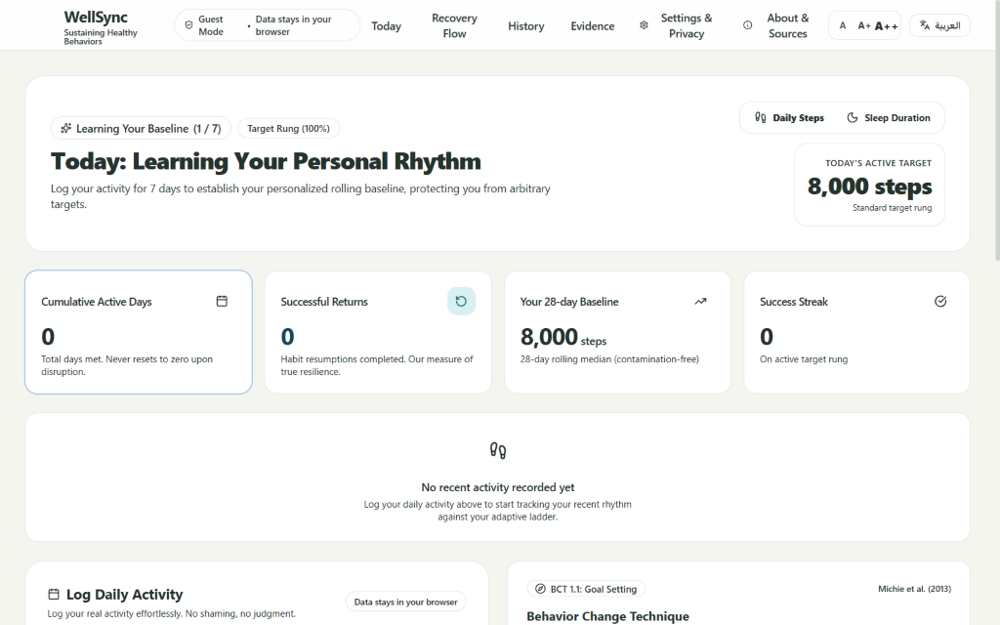
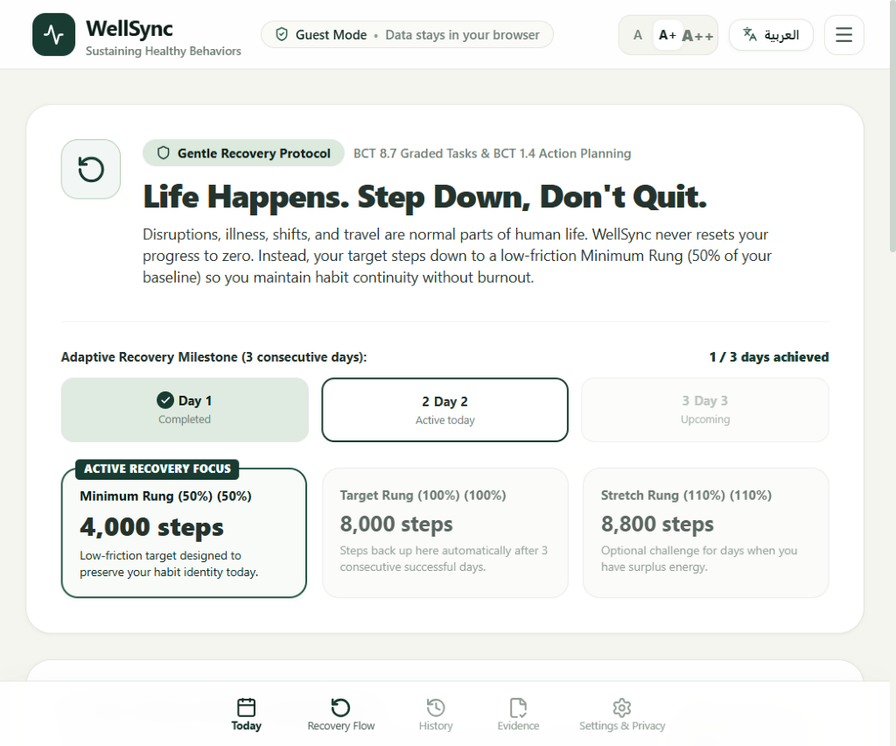
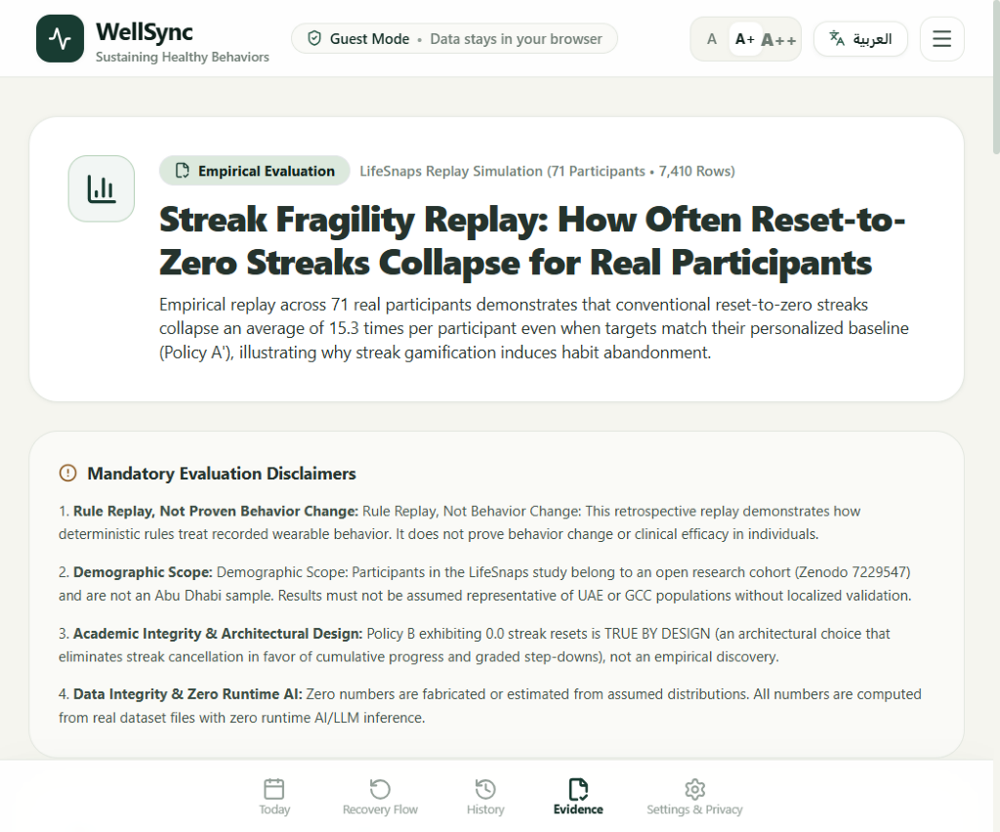

# WellSync: Sustaining Healthy Behaviors

> **Future Health Digital Innovation Challenge 2026 (Abu Dhabi)**  
> **Challenge 09**: Sustaining Healthy Behaviors | **Track**: Wellbeing  
> **Architecture**: Privacy-first, deterministic behavioral adaptation engine (Zero Runtime AI).

---

## 1. Problem, Solution & UAE Context

### The Problem
Most digital health tools rely on gamified streaks that reset to zero on a single missed day. When normal human fatigue, illness, or travel interrupts a routine, the broken streak induces the psychological *"What-the-Hell Effect"* (Marlatt & Gordon), causing users to interpret a temporary lapse as total failure and abandon the application entirely.

### The Solution
**WellSync** reframes habit durability around **recovery rather than unbroken perfection**. Instead of wiping out progress, its deterministic engine steps daily targets down to a manageable **50% Minimum Rung** during disruptions, permanently preserves **Cumulative Active Days**, and increments a **Return Count** for every rebound back to baseline. Users are guided by transparent Behavior Change Techniques (BCTTv1) without shame, punitive resets, or AI hallucinations.

### The UAE Context
Engineered specifically for the cultural, occupational, and environmental rhythms of Abu Dhabi and the UAE:
- **Rotating Shift-Work Mode**: Accommodates 12-hour hospital shifts (SEHA/M42 clinicians) with adapted 60% night-shift targets and rest-exempt recovery days.
- **Ramadan Fasting Mode**: Offline Hijri calendar calculations, 70% daytime scaling, and activity prompts post-Iftar and pre-Suhoor.
- **Summer Heat Mode**: Automatically pivots guidance toward climate-controlled mall-walking routes and indoor stairs during extreme temperatures (Jun–Sep).

---

## 2. Product Screenshots

| Today Screen (Adaptive Ladder) | Recovery Flow (Step-Down Rung) | Evidence Replay (Open Science) |
| :---: | :---: | :---: |
|  |  |  |

---

## 3. Architecture & Data Flow

WellSync enforces a strict **Local-First, Privacy-by-Default** design. Zero telemetry leaves the device unless the user explicitly opts into the optional pilot research layer.

```
+-----------------------------------------------------------------------------------+
| CLIENT BROWSER / DEVICE (Local-First Default)                                     |
|                                                                                   |
|  +--------------------+        +-----------------------------------------------+  |
|  | React 19 + Tailwind| -----> | Pure Deterministic Engine (src/engine/)       |  |
|  | - 3-Step Wizard    |        | - 28-Day Contamination-Free Rolling Median     |  |
|  | - 3-Rung Ladder    |        | - Anti-Erosion Frozen Baseline & Decay Caps   |  |
|  | - Arabic RTL / EN  |        | - 4 Context Modes (Shift, Ramadan, Heat, Pause|  |
|  +--------------------+        +-----------------------------------------------+  |
|            |                                           |                          |
|            v                                           v                          |
|  +--------------------+        +-----------------------------------------------+  |
|  | Browser LocalStore | <===== | State Machine Output:                         |  |
|  | (100% Offline Mode)|        | - ON_TRACK | SLIPPING | LAPSED | RECOVERING   |  |
|  +--------------------+        | - Cumulative Active Days & Return Count       |  |
|                                +-----------------------------------------------+  |
+-----------------------------------------------------------------------------------+
                                         |
                                         | [OPTIONAL OPT-IN ONLY: Zero PII, Pseudonymous]
                                         v
+-----------------------------------------------------------------------------------+
| OPTIONAL PILOT SERVER (/server)                                                   |
|                                                                                   |
|  +-------------------------------------+      +--------------------------------+  |
|  | Fastify 5 REST API (Node 20 + TS)   | ---> | SQLite Database (Cascade Delete|  |
|  | - POST /v1/consent                  |      | - participants (pseudo_id)     |  |
|  | - POST /v1/checkins (idempotent)    |      | - consents (timestamp, purpose)|  |
|  | - GET  /v1/export (GDPR/PDPL)       |      | - checkins (steps, sleep, flags|  |
|  | - DEL  /v1/participants/:id (hard)  |      | - engine_states                |  |
|  | - GET  /v1/pilot/aggregate (k >= 10)|      +--------------------------------+  |
|  +-------------------------------------+                                         |
+-----------------------------------------------------------------------------------+
```

---

## 4. Quick Start (Run in 2 Commands)

### Frontend (Client Application)
```bash
# 1. Install and start local development server
npm install
npm run dev
# Open http://localhost:5173
```

### Optional Pilot Server (Zero-PII Backend)
```bash
# 2. In a separate terminal, launch the pilot server
cd server
npm install
npm start
# Server listens on http://localhost:3001
```

---

## 5. Reproduce Evidence & Benchmarks

The entire evidence report and policy comparison can be recomputed deterministically from scratch:

```bash
# Runs the reproducible simulation against LifeSnaps parameters (Zenodo 7229547)
npm run evidence
```
Outputs:
- `src/data/evidence_data.json` (Consumed live by the UI Evidence screen)
- `evidence/EVIDENCE_REPORT.md` (Standalone markdown report)

---

## 6. Run Automated Test Suites

```bash
# 1. Frontend Test Suite (134 unit, property, and e2e journey tests)
npm test

# 2. Production Build Check (TypeScript + Vite)
npm run build

# 3. Server Integration Test Suite (8 cascade & privacy tests)
cd server && npm test
```

---

## 7. Submission Documentation Index

- **Pitch Document**: [`docs/PITCH.md`](./docs/PITCH.md) *(2-page executive summary in required 9-point order)*
- **Demo Script**: [`docs/DEMO_SCRIPT.md`](./docs/DEMO_SCRIPT.md) *(3-minute video presentation storyboard and timestamps)*
- **Security & Privacy Architecture**: [`docs/security.md`](./docs/security.md) *(UAE PDPL & GDPR compliance, zero-PII policy)*
- **Accessibility Report**: [`docs/accessibility.md`](./docs/accessibility.md) *(axe-core audit results & WCAG 2.1 AA checklist)*
- **Master Project Dossier**: [`WELLSYNC_MASTER_PROJECT_DOSSIER.md`](./WELLSYNC_MASTER_PROJECT_DOSSIER.md) *(Full technical specification and algorithm audit)*

---

## 8. Non-SaMD Clinical Disclaimer

> **Important Regulatory Notice**: WellSync is a non-clinical lifestyle habit maintenance and behavioral recovery support prototype. It is **NOT** a medical device, is **NOT** Software as a Medical Device (SaMD), does **NOT** provide clinical diagnoses, and does **NOT** prescribe medical therapy. All suggestions are non-medical habit adjustments intended for general wellbeing support.
