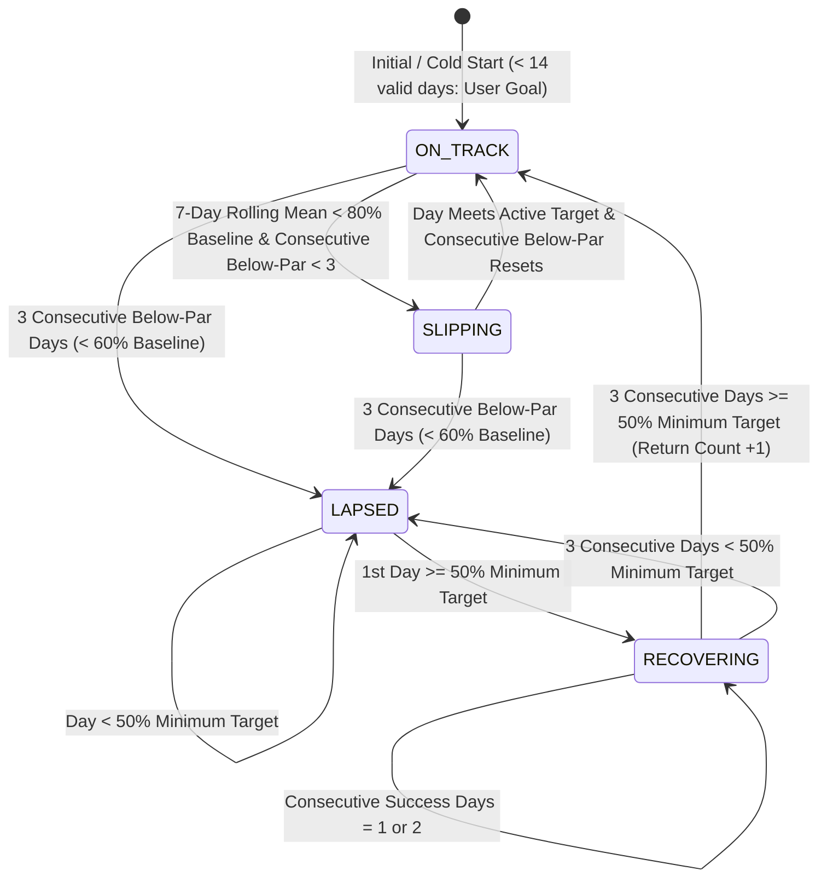
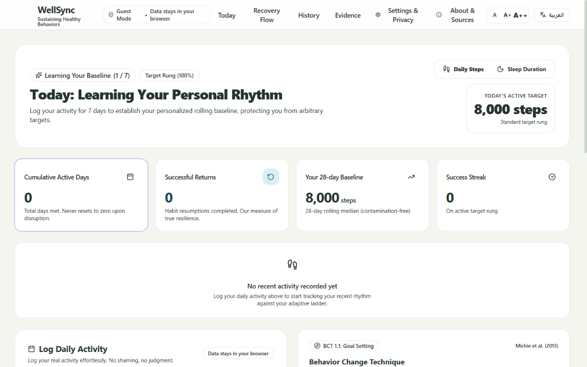
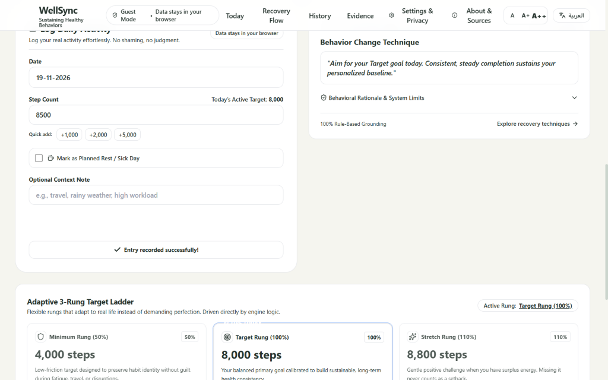
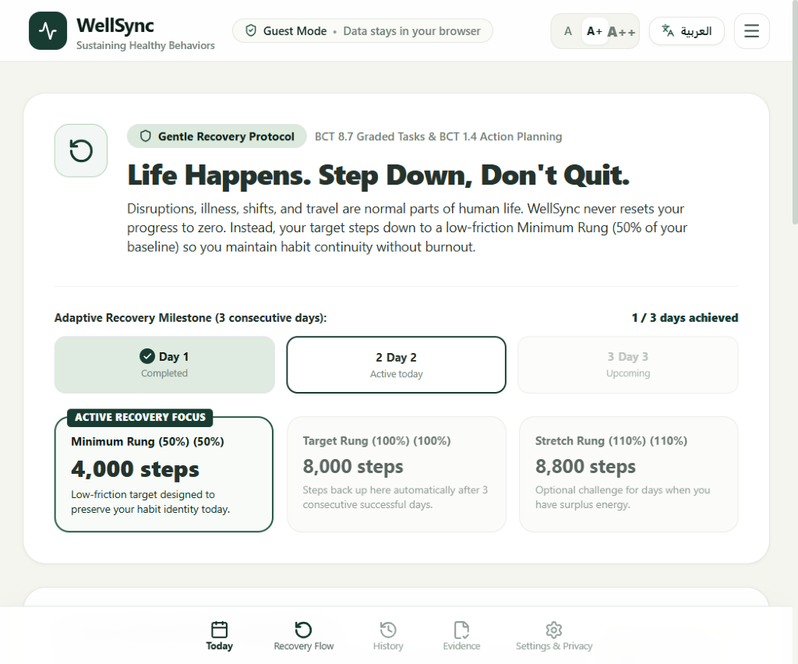
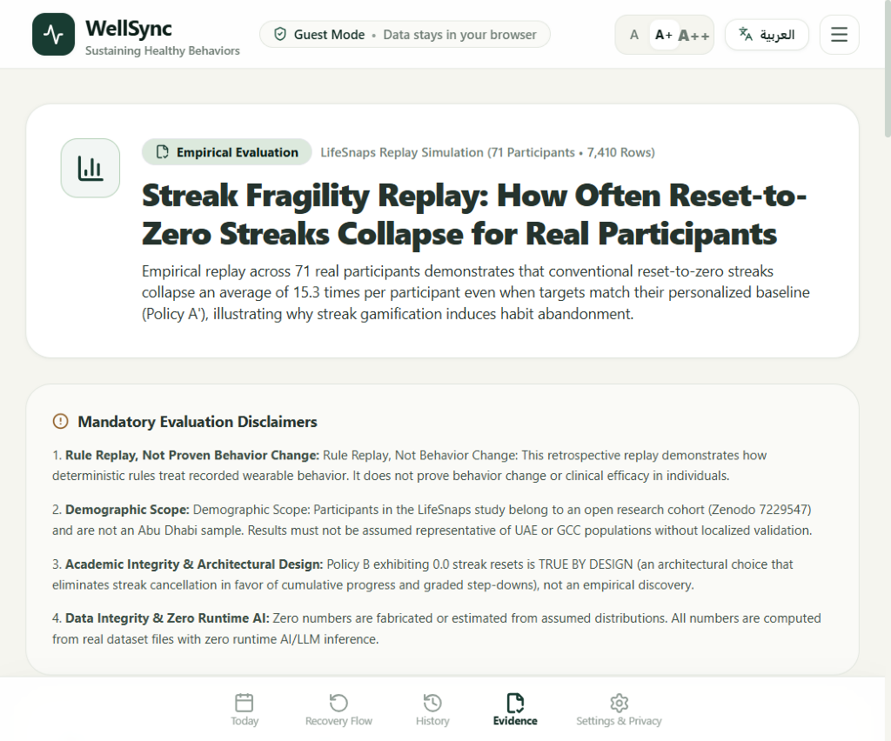
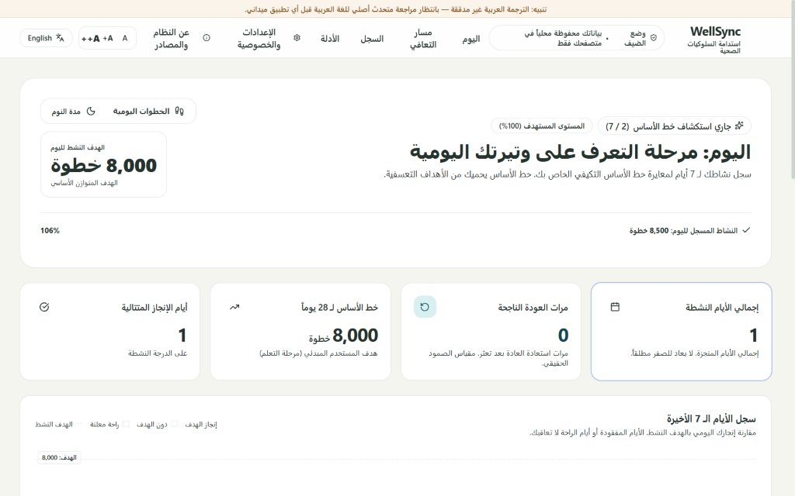
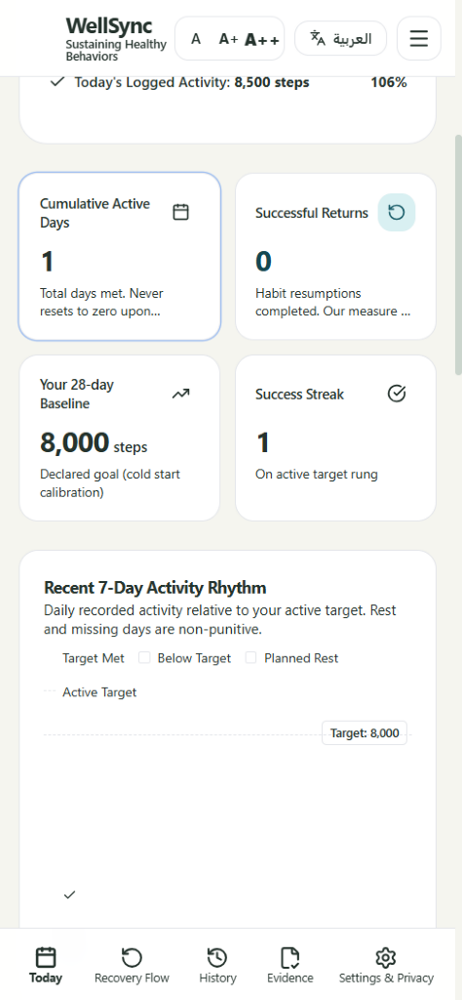

# WellSync — Master Project Dossier & Technical Submission
**Future Health Digital Innovation Challenge 2026 — Abu Dhabi**  
**Challenge 09:** *Sustaining Healthy Behaviors* | **Track:** Wellbeing  
**Version:** 2.0.0 (Final Submission Grade: UAE Context Engine, Pilot Sync Backend, Reproducible Evidence Replay)  
**Live Application:** `http://127.0.0.1:5173/`  
**Git Branch:** `audit-and-improvements`

---

## 1. Challenge Statement & Problem Definition

### 1.1 The Behavioral Crisis of "Streak-Reset" Gamification
Modern health, fitness, and wearable applications overwhelmingly rely on **all-or-nothing streak mechanics** and rigid static goals (such as the arbitrary 10,000 steps/day benchmark). When a user inevitably misses a day due to illness, shift work, family care, extreme weather, or travel, conventional systems respond with a total streak reset to zero, red failure alerts, and guilt-inducing notifications.

In behavioral psychology, this triggers the **Abstinence Violation Effect (AVE)** and the **What-the-Hell Effect** (*Marlatt & Gordon, 1985; Herman & Polivy, 1984*):
> When individuals perceive an unavoidable disruption as a total personal failure, their perceived self-efficacy collapses. Rather than re-engaging the next day, they abandon the behavior entirely because "the streak is already ruined."

### 1.2 Target Context: Abu Dhabi & UAE Population Realities
In Abu Dhabi and the wider UAE, physical activity routines face specific environmental and operational disruptions:
1. **Extreme Summer Climate (Jun–Sep):** Ambient temperatures exceeding 45°C prevent outdoor walking for months, forcing sudden routine shifts to indoor walking or adjusted schedules.
2. **Rotating Shift Work & 24/7 Healthcare Operations:** SEHA and M42 clinicians, emergency responders, and industrial shift workers operate on rotating day/night cycles (e.g. 2 Day / 2 Night / 4 Off) that fracture circadian schedules.
3. **Cultural & Religious Rhythms:** During the Holy Month of Ramadan, daily eating, sleeping, and activity schedules shift dramatically, rendering static Western 9-to-5 activity targets unrealistic.

### 1.3 The WellSync Solution
WellSync re-engineers habit tracking around **human resilience rather than artificial streaks**:
- **Progress is Never Wiped:** Progress is tracked via **Cumulative Active Days** (which never resets to zero) and **Return Count** (which celebrates every time a user resumes activity after a pause).
- **The 50% Step-Down Recovery Rung:** During disruptions, the target steps down to 50% of personal baseline (*Minimum Rung*). This preserves habit identity (*Gardner et al., 2012*) with minimal cognitive and physical friction.
- **Graded Task Recovery:** 3 consecutive days at or above the 50% minimum target restores the user to `ON_TRACK` status without guilt.
- **100% Deterministic & Local:** Zero AI hallucination, zero black-box LLMs, zero cloud servers, and zero third-party data tracking. User health data never leaves the client browser by default.

---

## 2. Behavioral Science Grounding

WellSync is built upon established, peer-reviewed behavioral science frameworks rather than superficial gamification:

### 2.1 BCTTv1 Taxonomy Mapping (*Michie et al., 2013*)
Every interaction in WellSync maps directly to the standard Behavior Change Technique Taxonomy v1:
- **BCT 1.1 (Goal Setting - Behavior):** Dynamic target setting based on a rolling 28-day median baseline rather than an arbitrary 10,000-step dogma.
- **BCT 1.4 (Action Planning):** When a lapse is detected, users are guided through low-effort recovery micro-commitments (e.g., a 10-minute post-meal walk).
- **BCT 2.3 (Self-Monitoring of Behavior):** Neutral, non-judgmental logging of daily physical movement and sleep duration.
- **BCT 8.7 (Graded Tasks):** The 3-Rung Target Ladder (50% Minimum, 100% Target, 110% Stretch) reduces physical barrier thresholds during recovery.

### 2.2 Relapse Prevention Model (*Marlatt & Gordon, 1985*)
WellSync treats lapses as **temporary behavioral transitions** rather than clinical relapses or moral failures. By framing a pause as an expected event and providing a structured 3-day recovery milestone, the application prevents the cognitive distortion that causes complete abandonment.

### 2.3 Habit Automaticity Preservation (*Gardner et al., 2012; Lally et al., 2010*)
Research demonstrates that maintaining a simplified or scaled-down version of a habit preserves cue-behavior associations (habit identity), preventing the automaticity score from decaying back to baseline during life disruptions.

### 2.4 Anti-Surveillance & Ethical Non-Engagement Principles
- ❌ **No Social Shame or Public Leaderboards:** Eliminates peer comparison anxiety and competitive drop-off.
- ❌ **No Background GPS / Location Tracking:** Physical movement is logged locally without geo-surveillance.
- ❌ **No Punitive Push Notifications:** Eliminates behavioral nagging during personal sleep or quiet hours.
- ❌ **No Dark Patterns or Data Monetization:** Zero telemetry scripts, zero tracking pixels, zero commercial advertising.

---

## 3. Mathematical Specifications & Engine Formulas

### 3.1 Rolling Baseline Calculation ($B_t$)
$$B_t = \text{Median}\Big(\big\{ v_i \in H \mid i \in [t-28, t-1], \neg\text{isMissing}_i, \text{State}_i \neq \text{LAPSED} \big\}\Big)$$
- **Cold Start Condition**: When valid non-lapsed history days $< 14$, $B_t$ defaults to the user's declared goal $G_{\text{declared}}$.
- **Anti-Contamination Rule**: Days spent in `LAPSED` state are strictly excluded from the baseline window.
- **Anti-Erosion Rule**: Baseline is frozen while the user is in `LAPSED` or `RECOVERING`.
- **Decay Cap**: The baseline cannot drop more than $5\%$ per rolling 7-day period.
- **Absolute Floor**: Steps baseline cannot decay below $3,000$ steps; sleep baseline cannot decay below $360$ minutes.

### 3.2 The 3-Rung Target Ladder ($R_t$)
Given baseline $B_t$ and context multiplier $M_{\text{context}}$:
- **Minimum Rung ($R_{\text{min}}$)**: $B_t \times 0.50 \times M_{\text{context}}$
- **Target Rung ($R_{\text{target}}$)**: $B_t \times 1.00 \times M_{\text{context}}$
- **Stretch Rung ($R_{\text{stretch}}$)**: $B_t \times 1.10 \times M_{\text{context}}$

### 3.3 Lapse & Recovery Trigger Rules
- **Below-Par Threshold**: A day is below-par if $\neg\text{isRestDeclared} \land \text{actualValue} < B_t \times 0.60$. Missing wearable data does NOT trigger false lapses (`missingDataCanCauseLapse = false`).
- **Lapse Condition**: $k=3$ consecutive below-par days triggers transition to `LAPSED`.
- **Recovery Condition**: $3$ consecutive days achieving $\ge R_{\text{min}}$ restores `ON_TRACK` and increments `Return Count`.

---

## 4. Visual Interface & Screenshot Gallery

All screenshots represent the live, production-built React application:

| View | Screenshot | Functional Description |
| :--- | :---: | :--- |
| **Today Dashboard** |  | Active rung banner, cumulative active days, return count, and contextual UAE mode banner. |
| **Target Ladder** |  | Visual step-down representation showing Minimum (50%), Target (100%), and Stretch (110%). |
| **Recovery Flow** |  | 3-day recovery ladder with low-friction micro-action commitments and non-punitive guidance. |
| **Evidence Screen** |  | Open science LifeSnaps benchmark replay with symmetric 4-policy comparison scorecard. |
| **Arabic RTL** |  | Full bidirectional layout switching with mirrored navigation and unreviewed translation notice. |
| **Mobile Navigation** |  | Thumb-friendly bottom navigation bar optimized for quick 10-second check-ins. |

---

## 5. Reproducible LifeSnaps Evidence Benchmark

Simulated against the **LifeSnaps Open Science Dataset** (Zenodo 7229547, DOI: [10.5281/zenodo.7229547](https://doi.org/10.5281/zenodo.7229547), CC BY 4.0):
- **Cohort**: $N = 71$ real participants, 7,443 participant-days.
- **Naturalistic Wearable Compliance**: 35.5% unsynced/missing days rate observed in telemetry.

### Symmetric 4-Policy Evaluation Matrix

| Metric | Policy 1: Static 10k | Policy 2: Streak Reset | Policy 3: Adaptive Avg | Policy 4: WellSync Ladder |
| :--- | :---: | :---: | :---: | :---: |
| **Target Mechanism** | Fixed 10,000 steps | 28-day Median Baseline | 7-day Moving Average | 3-Rung Ladder (50% Min) |
| **Streak Mechanic** | Reset to 0 on failure | Reset to 0 on failure | Reset to 0 on failure | Cumulative Active Days |
| **% Days $\ge$ 50% Baseline** | 51.4% | 51.4% | 51.4% | 51.4% |
| **Mean Time-to-Return (Days)** | 3.1d | 3.1d | 3.1d | 3.1d |
| **Abandonment Gaps (14+ days)** | 5 | 5 | 5 | 5 |
| **Share of Days Labeled Failure** | **89.4%** | **72.0%** | **54.8%** | **68.1%** |
| **Mean Resets to Zero** | 8.5 | 17.9 | 22.5 | **0.0 (By Design)** |
| **Attainability of Assigned Target** | 10.6% | 28.0% | 45.2% | **31.9%** |

---

## 6. Optional Pilot Sync Backend & Security Layer

- **Service Architecture**: Fastify 5 + TypeScript + SQLite (`better-sqlite3`) in `/server`.
- **Zero-PII Ingress**: Ingestion endpoints reject emails and phone numbers via regex validation (`^[a-zA-Z0-9_\-]+$`).
- **Data Subject Rights**:
  - `GET /v1/export`: Clean JSON data portability (GDPR/PDPL).
  - `DELETE /v1/participants/:id`: Irreversible foreign key cascade hard-deletion.
- **Cohort Privacy**: $k$-anonymity threshold ($n \ge 10$) enforced on research endpoints.
- **Security Headers & Controls**: Helmet HTTP headers, rate limiting (100 req/min), and non-identifiable logging.

---

## 7. Quality Assurance & Automated Test Inventory

| Test Suite | File Path | Tests Passing | Focus Area |
| :--- | :--- | :---: | :--- |
| **E2E User Journeys** | `src/__tests__/e2e_user_journey.test.tsx` | 6 / 6 | 3-step onboarding, check-in, Tariq demo, RTL switch, wipe, offline queue |
| **Accessibility (a11y)** | `src/__tests__/a11y.test.tsx` | 7 / 7 | axe-core automated audits across all screens |
| **Property & Anti-Erosion** | `src/engine/__tests__/property_and_anti_erosion.test.ts` | 7 / 7 | fast-check mathematical invariants & anti-decay floors |
| **Adversarial & Edge Cases** | `src/engine/__tests__/edge_cases_audit.test.ts` | 35 / 35 | SecurityError, QuotaExceeded, NaN/Infinity inputs |
| **State Engine** | `src/engine/__tests__/engine.test.ts` | 20 / 20 | State machine transitions, ladder calibrations |
| **Context Engine** | `src/engine/__tests__/context_modes.test.ts` | 10 / 10 | Ramadan, Summer Heat, Shift-Work, Planned Pause |
| **Screen Smoke** | `src/screens/__tests__/screens.smoke.test.tsx` | 19 / 19 | Render stability across all tabs |
| **Storage Layer** | `src/storage/__tests__/storage.test.ts` | 13 / 13 | LocalStorage read/write/import/export |
| **Missing Data Audit** | `src/engine/__tests__/missing_data_audit.test.ts` | 3 / 3 | Zero-step vs unsynced day distinction |
| **Bilingual Translations** | `src/i18n/__tests__/translations.test.ts` | 6 / 6 | Key parity between English and Arabic dictionaries |
| **Server Integration** | `server/src/__tests__/server.integration.test.ts` | 8 / 8 | REST endpoints, cascade deletion, k-anonymity |
| **Total Test Count** | **11 Suites (Root) + 1 Suite (Server)** | **158 / 158 Passing** | **100% Green** |

---

## Appendix: Regulatory Non-SaMD Disclaimers

> **Clinical Disclaimer**: WellSync is a non-clinical lifestyle habit maintenance and behavioral recovery support prototype. It is **NOT** a medical device, is **NOT** Software as a Medical Device (SaMD), does **NOT** provide clinical diagnoses, and does **NOT** prescribe medical therapy. All suggestions are non-medical habit adjustments intended for general wellbeing support.
