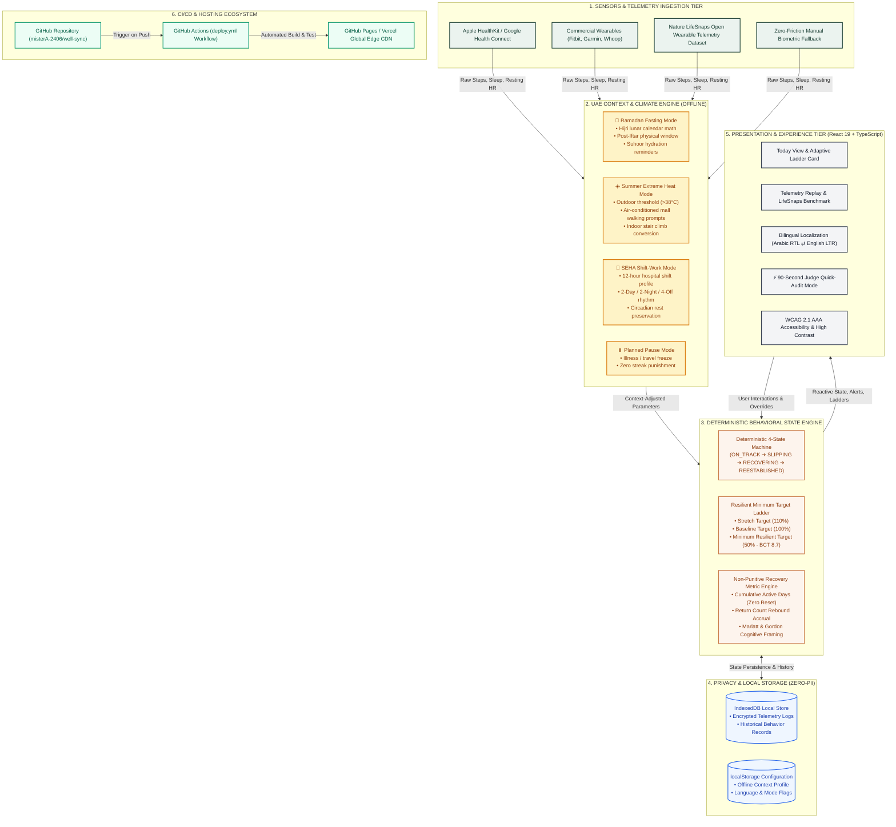
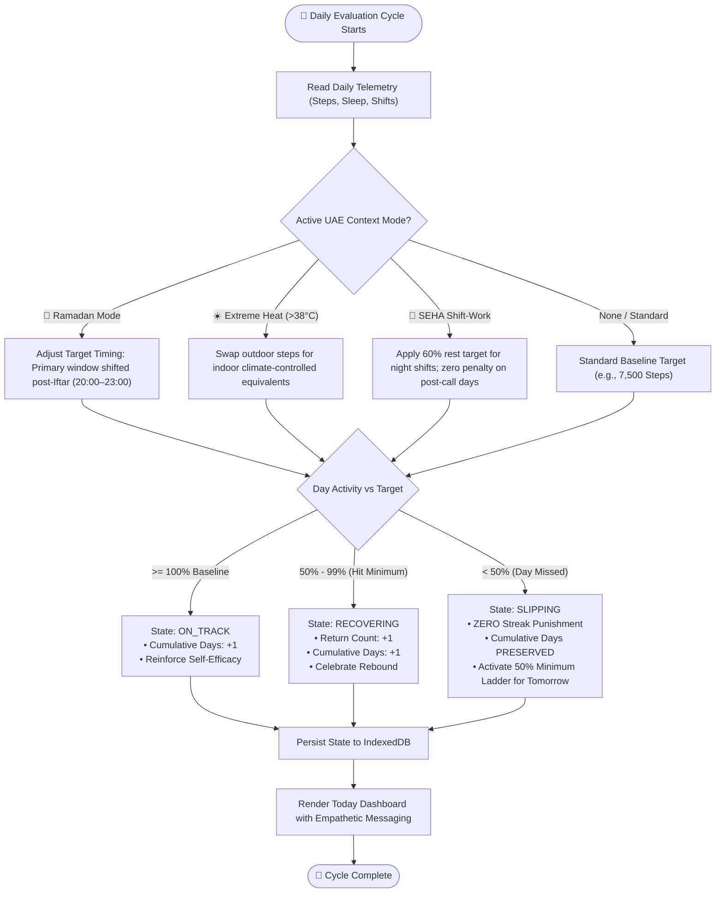
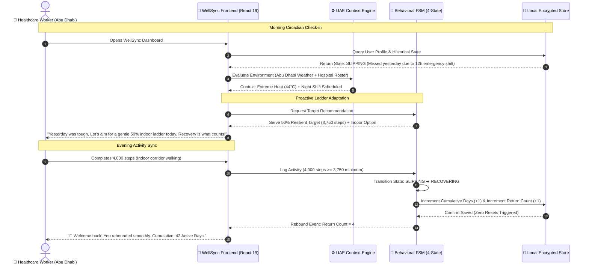
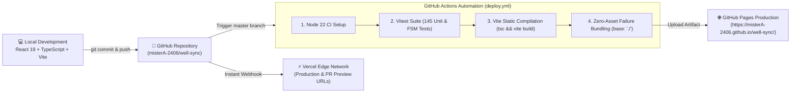

# WellSync: System Architecture & Behavioral Recovery Workflow
**Future Health Digital Innovation Challenge 2026 — Abu Dhabi**  
*Challenge 09: Sustaining Healthy Behaviors (Wellbeing Track)*  
*Engineered by: 1. Ayesha Sultana & 2. B. Alence (Student Software Engineers)*  
*GitHub: [github.com/misterA-2406/well-sync](https://github.com/misterA-2406/well-sync)*

---

## 1. High-Level Multi-Tier System Architecture

WellSync is engineered as a **100% client-side, local-first, privacy-preserving behavioral health platform**. It operates entirely within the user's browser without external cloud tracking, third-party biometrics harvesting, or black-box LLM hallucinations.



---

## 2. The 4-State Behavioral Recovery Workflow

Traditional health apps use binary streaks: a missed day drops the user's progress to **0**, causing the psychological **"What-the-Hell Effect"** (*Marlatt & Gordon*), where users abandon their health interventions. 

WellSync replaces this punitive loop with an adaptive **4-State Finite State Machine (FSM)**:

```mermaid
stateDiagram-v2
    [*] --> ON_TRACK: User starts baseline routine

    state ON_TRACK {
        description: User is achieving 100%+ of baseline target.
        metric: Cumulative Active Days accrues daily.
    }

    state SLIPPING {
        description: 1-2 consecutive days below baseline target.
        intervention: Adaptive Ladder automatically offers 50% Minimum Resilient Target (BCT 8.7).
        cognitive_frame: "Normal fluctuation, not failure."
    }

    state RECOVERING {
        description: User completes the 50% Minimum Target or resumes activity.
        metric: Return Count increments (+1).
        celebration: "Rebound achieved! Habit durability strengthened."
    }

    state REESTABLISHED {
        description: 3 consecutive days meeting/exceeding baseline.
        metric: Solidified habit durability returned to full capacity.
    }

    ON_TRACK --> SLIPPING: Missed Day (Shift work, illness, heat)
    SLIPPING --> ON_TRACK: Complete baseline next day
    SLIPPING --> RECOVERING: Complete 50% Minimum Resilient Target (BCT 8.7)
    SLIPPING --> RECOVERING: Return after multiple missed days (No Reset!)
    RECOVERING --> REESTABLISHED: 3 consecutive days at baseline
    RECOVERING --> SLIPPING: Missed day during recovery phase
    REESTABLISHED --> ON_TRACK: Seamless continuity
```

### Detailed Decision Flowchart



---

## 3. Daily User Journey & Context Adaptation Sequence



---

## 4. Resilient Minimum Ladder (BCT 8.7) Mathematical Model

```
   ┌────────────────────────────────────────────────────────┐
   │ ▲ STRETCH RUNG (110% = 8,250 Steps)                   │
   │   Peak days, high energy, surplus capacity             │
   ├────────────────────────────────────────────────────────┤
   │ ◼ BASELINE RUNG (100% = 7,500 Steps)                  │
   │   Standard operational target for routine days         │
   ├────────────────────────────────────────────────────────┤
   │ ▼ MINIMUM RESILIENT RUNG (50% = 3,750 Steps)          │
   │   Disruption recovery (BCT 8.7 Graded Tasks)           │
   │   Prevents "What-the-Hell Effect" & preserves habit    │
   └────────────────────────────────────────────────────────┘
```

---

## 5. Deployment & CI/CD Pipeline Architecture


