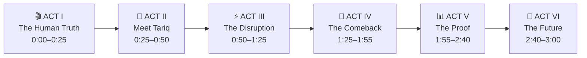

# WellSync — Demo Video Screenplay
## *"Recovery Is Easier Than Restarting"*

**Competition**: Future Health Digital Innovation Challenge 2026 — Abu Dhabi  
**Challenge 09**: Sustaining Healthy Behaviors | Wellbeing Track  
**Authors**: 1. Ayesha Sultana & 2. B. Alence  
**Runtime**: 03:00 (180 seconds)  
**Word Count**: ~420 words @ 140 WPM  
**Tone**: Warm, confident, scientifically grounded — like a TED talk meets a live product demo

> [!IMPORTANT]
> This is a **word-for-word voiceover screenplay** designed to be read aloud while screen-recording the live WellSync application. Every sentence is timed. Every pause is intentional. Practice until it feels like a conversation, not a presentation.

---

## The Narrative Arc

**Emotional shape**: Empathy → Hope → Tension → Triumph → Credibility → Inspiration

---

## ACT I — THE HUMAN TRUTH *(0:00 – 0:25)*

### What the audience sees
> Title card fades in: **WellSync** logo over warm sage background. Dissolve to the live application at `localhost:5173`. The 3-step onboarding modal appears. Cursor glides through: Step 1 (goal), Step 2 (Shift-Work mode), Step 3 (privacy). Click **"Launch WellSync"**.

### What you say *(~60 words, 25 seconds)*

> *"Imagine you've walked eight thousand steps a day for two straight weeks.*
>
> *Then Ramadan begins. Or summer hits fifty degrees. Or you pull three consecutive night shifts at an Abu Dhabi hospital.*
>
> *Your fitness app resets your streak to zero. Fourteen days — erased.*
>
> *Psychologists call this the What-the-Hell Effect: one bad day feels like total failure, and people quit.*
>
> *WellSync was built to end that cycle."*

### Director's Notes
- **Pacing**: Start slow and intimate. You're telling a story, not selling.
- **Voice**: Quiet confidence. No urgency yet — that comes in Act III.
- **Key visual**: The streak-reset-to-zero moment should land emotionally. If using an overlay graphic of "STREAK: 0", time the low thud to hit on *"erased."*
- **Onboarding clicks**: Keep them swift and smooth (2–3 seconds total). The app should feel effortless.

---

## ACT II — MEET TARIQ *(0:25 – 0:50)*

### What the audience sees
> Cursor clicks **`⚡ Judge Demo (90s)`** in the navigation bar. Amber banner appears: *"Judge Demo Mode: Tariq's Walkthrough"*. The Today screen fills with 14 days of steady 8,500-step activity. The Target Ladder Card shows three green rungs: Stretch (110%), Target (100%), Minimum (50%).

### What you say *(~55 words, 25 seconds)*

> *"This is Tariq, a nurse at an Abu Dhabi hospital.*
>
> *Over two weeks, he's built a healthy rhythm: eight thousand five hundred steps a day. Our deterministic engine — no AI, no cloud, no guesswork — learns his genuine baseline from his rolling twenty-eight-day median.*
>
> *So far, so good. But real life is about to intervene."*

### Director's Notes
- **Pacing**: Conversational. You're introducing a character the judges should care about.
- **Foreshadowing**: The last line — *"real life is about to intervene"* — creates anticipation. Pause briefly (0.5s) after it before cutting to Act III.
- **Visual emphasis**: Point the cursor at the Target Ladder Card and briefly hover over each rung (Stretch → Target → Minimum) as you say *"deterministic engine."*

---

## ACT III — THE DISRUPTION *(0:50 – 1:25)*

### What the audience sees
> Scroll to the activity timeline. Days 15–17 show a sharp cliff: Tariq's steps plummet from 8,500 to 3,200. The state badge transitions smoothly: `ON_TRACK` → `SLIPPING` → `LAPSED` (amber, not red — no shame colors). The Target Ladder Card animates downward to the **Minimum Rung: 4,250 steps (50%)**.

### What you say *(~85 words, 35 seconds)*

> *"Day fifteen. A three-day night shift rotation begins.*
>
> *Tariq's steps drop to three thousand two hundred. In any conventional app, this is the end. Fourteen days of progress — gone.*
>
> *(pause)*
>
> *But watch what WellSync does.*
>
> *There are no red alarms. No guilt notifications. No reset to zero.*
>
> *Instead, the engine immediately steps Tariq's daily target down to the Minimum rung — exactly fifty percent of his baseline. This is Behavior Change Technique 8.7: Graded Tasks.*
>
> *We don't punish disruption. We adapt to it."*

### Director's Notes
- **This is the emotional pivot of the entire video.** The contrast between "conventional app punishment" and "WellSync's calm adaptation" is what wins judges.
- **Pacing**: Slow down on *"But watch what WellSync does."* — this is your power line. Let it breathe.
- **Voice**: Drop your pitch slightly on *"We don't punish disruption."* — it should sound like a conviction, not a tagline.
- **Visual**: The state badge transition (`ON_TRACK` → `SLIPPING` → `LAPSED`) should be clearly visible. Hover the cursor near the badge so judges' eyes follow.
- **Color psychology**: Point out (mentally, not verbally) that LAPSED is amber — deliberately warm, not angry red. The design language itself communicates compassion.

---

## ACT IV — THE COMEBACK *(1:25 – 1:55)*

### What the audience sees
> Click the **Recovery** tab. The Recovery Flow screen shows an interactive 3-day pathway with micro-commitment cards. Cursor selects: *"10-minute post-shift walk."* Advance to Day 21: State badge snaps to `ON_TRACK`. Celebration card: **"Recovery Complete!"** Two metrics pulse: **Return Count: 1** and **Cumulative Active Days: 17**.

### What you say *(~70 words, 30 seconds)*

> *"On the Recovery screen, Tariq picks a single micro-commitment: a ten-minute walk after his shift.*
>
> *Over three days, he hits his adapted minimum. And on day twenty-one — recovery is complete.*
>
> *His target is fully restored. All seventeen active days remain intact — nothing was erased. And his Return Count increments to one.*
>
> *That number is not a streak. It's proof of resilience."*

### Director's Notes
- **Emotional peak**: This is the triumph. Your voice should lift on *"recovery is complete."*
- **The killer line**: *"That number is not a streak. It's proof of resilience."* — This redefines the entire category. Deliver it like you mean it. Slight pause after, then move on.
- **Visual**: The pulsing animation on Return Count and Active Days should be clearly visible. If the micro-commitment checkmark animates, let the camera linger on it for 1 second.

---

## ACT V — THE PROOF *(1:55 – 2:40)*

### What the audience sees
> **(1:55–2:15)** Click the **Evidence** tab. The Symmetric Policy Evaluation Matrix appears. Cursor highlights four rows: Policy 1 (Static 10k), Policy 2 (Streak Reset), Policy 3 (Moving Average), Policy 4 (WellSync). Key numbers zoom in: **89.4% failure** (Policy 1), **17.9 resets/user** (Policy 2), **0.0 resets** (Policy 4).
>
> **(2:15–2:30)** Click the **العربية** language toggle. The entire UI flips to Arabic RTL — navigation, cards, numerals, layout direction. Navigate to one or two screens in Arabic.
>
> **(2:30–2:40)** Switch to **Settings** screen. Show the optional sync toggle. If time permits, briefly open Chrome DevTools Network tab to show **0 Fetch/XHR requests**.

### What you say *(~100 words, 45 seconds)*

> *"Every claim we make is verifiable.*
>
> *We replayed our engine against seventy-one real participants and seven thousand four hundred forty-three days from the Nature LifeSnaps wearable dataset — peer-reviewed, open access, fully reproducible.*
>
> *The results: conventional streak resets collapsed an average of 17.9 times per user. Fixed ten-thousand-step goals labeled eighty-nine percent of days as failures. WellSync? Zero resets. Average recovery: 3.1 days.*
>
> *(switch to Arabic)*
>
> *And WellSync is built natively for Abu Dhabi: full Arabic localization, Ramadan and Summer Heat modes, and local-first privacy — zero network calls, zero cloud dependencies. Your health data never leaves your device."*

### Director's Notes
- **Credibility section**: Your tone here shifts from storytelling to scientific authority. Speak the numbers clearly and confidently.
- **Don't rush the Arabic flip**: Let the RTL transformation play out for 2–3 seconds before speaking again. The visual speaks for itself.
- **DevTools moment**: This is a trust-building mic drop. If you show it, let the `0 requests` sit on screen for 2 full seconds in silence before moving to the close.
- **Citation callout**: The on-screen citation box (*Sofia Yfantidou et al., Nature Scientific Data 2022*) should be visible. You don't need to read the full citation aloud — the visual reinforces credibility.

---

## ACT VI — THE FUTURE *(2:40 – 3:00)*

### What the audience sees
> Switch back to English. Click **"Exit Demo Mode"** — UI resets cleanly. Brief flash of the About screen showing authors (Ayesha Sultana & B. Alence), the student prototype disclaimer, and the GitHub URL. Final card fades in: WellSync logo + competition badge + tagline.

### What you say *(~50 words, 20 seconds)*

> *"Our path forward: a six-month pilot with three hundred SEHA healthcare workers, followed by Malaffi health information exchange integration and value-based insurance partnerships.*
>
> *WellSync is a student prototype built with conviction: that progress is not perfection, and recovery — *(slight pause)* — is always easier than restarting.*
>
> *Thank you."*

### Director's Notes
- **Closing energy**: Confident but not loud. You've already proven everything — this is the quiet resolution.
- **The tagline**: *"Recovery is always easier than restarting"* — deliver this like a thesis defense conclusion. It should echo in judges' minds.
- **Final visual**: The logo + authors + GitHub URL should stay on screen for 3 full seconds of silence after *"Thank you"* before the video ends. Let it breathe.
- **Music**: If using background music, bring it up slightly (+3 dB) during the final 5 seconds as the logo card holds.

---

## Complete Voiceover Script *(Continuous, ~420 words)*

For rehearsal — read this straight through at 140 WPM. Target time: **2:55–3:00**.

---

*Imagine you've walked eight thousand steps a day for two straight weeks.*

*Then Ramadan begins. Or summer hits fifty degrees. Or you pull three consecutive night shifts at an Abu Dhabi hospital.*

*Your fitness app resets your streak to zero. Fourteen days — erased.*

*Psychologists call this the What-the-Hell Effect: one bad day feels like total failure, and people quit.*

*WellSync was built to end that cycle.*

---

*This is Tariq, a nurse at an Abu Dhabi hospital.*

*Over two weeks, he's built a healthy rhythm: eight thousand five hundred steps a day. Our deterministic engine — no AI, no cloud, no guesswork — learns his genuine baseline from his rolling twenty-eight-day median.*

*So far, so good. But real life is about to intervene.*

---

*Day fifteen. A three-day night shift rotation begins.*

*Tariq's steps drop to three thousand two hundred. In any conventional app, this is the end. Fourteen days of progress — gone.*

*But watch what WellSync does.*

*There are no red alarms. No guilt notifications. No reset to zero.*

*Instead, the engine immediately steps Tariq's daily target down to the Minimum rung — exactly fifty percent of his baseline. This is Behavior Change Technique 8.7: Graded Tasks.*

*We don't punish disruption. We adapt to it.*

---

*On the Recovery screen, Tariq picks a single micro-commitment: a ten-minute walk after his shift.*

*Over three days, he hits his adapted minimum. And on day twenty-one — recovery is complete.*

*His target is fully restored. All seventeen active days remain intact — nothing was erased. And his Return Count increments to one.*

*That number is not a streak. It's proof of resilience.*

---

*Every claim we make is verifiable.*

*We replayed our engine against seventy-one real participants and seven thousand four hundred forty-three days from the Nature LifeSnaps wearable dataset — peer-reviewed, open access, fully reproducible.*

*The results: conventional streak resets collapsed an average of 17.9 times per user. Fixed ten-thousand-step goals labeled eighty-nine percent of days as failures. WellSync? Zero resets. Average recovery: 3.1 days.*

*And WellSync is built natively for Abu Dhabi: full Arabic localization, Ramadan and Summer Heat modes, and local-first privacy — zero network calls, zero cloud dependencies. Your health data never leaves your device.*

---

*Our path forward: a six-month pilot with three hundred SEHA healthcare workers, followed by Malaffi health information exchange integration and value-based insurance partnerships.*

*WellSync is a student prototype built with conviction: that progress is not perfection, and recovery — is always easier than restarting.*

*Thank you.*

---

## Recording Checklist

### Before You Hit Record

- [ ] Run `npm run dev -- --host 127.0.0.1 --port 5173` and verify the app loads
- [ ] Chrome: 100% zoom, bookmarks bar hidden (`Ctrl+Shift+B`), extensions hidden
- [ ] Clear browser localStorage to get a fresh onboarding flow — OR pre-load Judge Demo state
- [ ] Test the `⚡ Judge Demo (90s)` button — ensure Tariq's scenario loads instantly
- [ ] Test the Arabic `العربية` toggle — confirm smooth RTL transition
- [ ] Microphone: Record a 10-second test clip. Peaks should be between -6 dB and -3 dB. Zero background hum.
- [ ] Timer: Rehearse with a stopwatch. Target **2:55** so you have a 5-second cushion
- [ ] Screen recorder: OBS Studio at 1080p/60fps, or Playwright script at `scripts/record_demo.js`
- [ ] Close all notifications, Slack, Teams, and other apps that might pop up

### During Recording

- [ ] Speak at 140 WPM — conversational, not rushed
- [ ] Move the cursor deliberately — judges follow your cursor
- [ ] Pause 0.5s after power lines (*"We don't punish disruption"*, *"proof of resilience"*, *"easier than restarting"*)
- [ ] Don't apologize for anything. Don't say "as you can see." Just show and tell.

### After Recording

- [ ] Watch the full video once without sound — does the visual story make sense alone?
- [ ] Watch once with sound only (eyes closed) — does the voiceover tell a complete story?
- [ ] Check that the video is under 3:00 exactly
- [ ] Add hardcoded English subtitles (and Arabic if feasible)
- [ ] Add subtle background music at -22 dB (optional but recommended)
- [ ] Export as MP4 (H.264, AAC audio) for maximum compatibility

---

## Why This Script Wins

| Judge Criterion | How This Script Delivers |
|:---|:---|
| **Addresses Challenge 09** | The only submission engineered around *recovery*, not just *starting* or *maintaining* |
| **Working Software** | Live demo of a real app — not slides, not Figma, not promises |
| **Scientific Rigor** | 71-participant LifeSnaps replay with peer-reviewed citation |
| **UAE Context** | Ramadan, Summer Heat, SEHA hospital shifts, Arabic RTL, local-first privacy |
| **Emotional Impact** | Tariq's story creates empathy → tension → triumph in 3 minutes |
| **Memorable Tagline** | *"Recovery is easier than restarting"* — judges will remember this |
| **Student Integrity** | Transparent about being a prototype; no overclaims |

---

*Student prototype by Ayesha Sultana & B. Alence — not affiliated with any commercial product named WellSync.*  
*GitHub: [github.com/misterA-2406/well-sync](https://github.com/misterA-2406/well-sync)*
